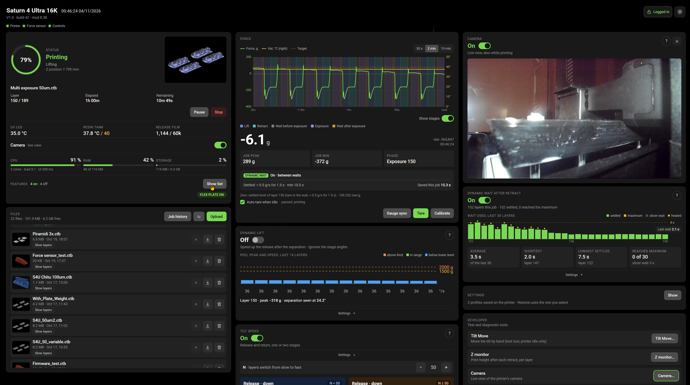
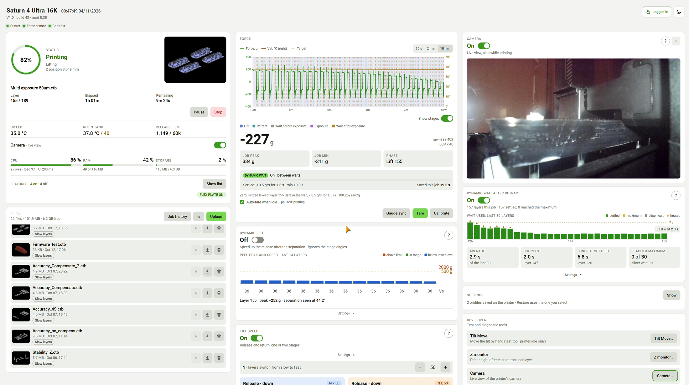

# saturn4-fw – open firmware mod for the Elegoo Saturn 4 Ultra 16K

An unofficial, **customer-volume-only** modification of the stock firmware **V1.5.9** of the
Elegoo Saturn 4 Ultra 16K (SigmaStar SSC011A / Infinity2M, app `chitu`). It adds a web
dashboard served by the printer itself and a set of print-quality features that the stock
firmware does not have. It is installed with the normal **USB firmware update**, and it can be
removed the same way.

**Everything runs inside the printer.** There is no app, driver or program to install on a computer, phone or
tablet: open the dashboard in an ordinary web browser, from any device on the same network (PC, Mac, Linux,
Android, iOS), at `http://<printer-ip>/`.

> **Not affiliated with, endorsed or supported by Elegoo.** This repository contains **no
> Elegoo firmware**: you download the official V1.5.9 yourself and build the image on your own
> computer. Use it at your own risk (GPL-3.0, no warranty). Read [Safety](#safety) first.

## Screenshots

The dashboard in the dark theme (default) and the light theme, during a print with the camera live view on:





## What it does

All settings are made in a dashboard at `http://<printer-ip>/` (reading is open, anything that
changes the printer needs the printer password).

| Area | Features |
|---|---|
| **Force** | Live build-plate force (grams), per-print CSV job logs, calibration wizard, auto-tare, peel peak per layer |
| **Waits** | *Dynamic wait*: start the exposure when the resin has settled instead of after the slicer's fixed wait; *Wait & heat*; *gauge sync* |
| **Tilt** | Custom tilt speeds, a fix for the two-stage release/return bug, *Dynamic lift* (adaptive peel speed), slow layers per file, tilt-move test tool |
| **Exposure** | Manual exposure override (with or without a running job), *Multi Exposure* (own UV time per screen quadrant, for test prints), Z monitor (plate height per layer, for variable layer height prints) |
| **Heating** | Resin pre-heat, heating during print, optional plate move into the resin |
| **Printer set-up** | Flex-plate compensation (writes the whole set of Z values), machine-settings file upload with backups, settings profiles per print file |
| **Safety / ops** | Login with the printer password, print alert pop-ups (foreign matter, resin level, probe/level/home failures), job history, *Return to stock firmware* button, kill switches for every part |

The full documentation of every function (with screenshots) is
[`docs/user_manual.html`](docs/user_manual.html).

## How it works (short)

* `mods/src/sgtap/` – **`libsgtap.so`**, an `LD_PRELOAD` library that is loaded into the stock
  app. It taps the strain-gauge serial line, follows the app's log, and patches a few values in
  the app's memory. Every patch is guarded: the library checks the exact machine code of V1.5.9 at
  fixed addresses first and does nothing on any other version.
* `mods/customer/` – files copied into the printer's `/customer` volume: the start hook, the
  dashboard page (`mod/www/index.html`), the helper service (`sgwebd.tcl`, Jim Tcl), boot guard,
  stock-restore script.
* `tools/` – unpack / repack the update container, build the UBIFS volume and the image, RE
  helpers (capstone), analysis scripts, a telnet runner.

Only the `customer` UBI volume is replaced. Bootloader, partition layout, kernel and root
filesystem stay stock. More: [`docs/ARCHITECTURE.md`](docs/ARCHITECTURE.md).

## Requirements

* A Saturn 4 Ultra 16K running **V1.5.9** (other versions are not supported: the guards refuse).
* **The image must be built from YOUR printer's own firmware.** The Saturn 4 Ultra 16K exists in several board
  revisions that ship slightly different firmware (different app build, FPGA bitstream, Wi-Fi/camera/driver
  details). The mod patches the app at fixed addresses, so a build made from one revision's firmware is not valid
  for another. Check your printer's firmware version and board first (run the read-only report in
  [`board-report/`](board-report/)); if it is not the V1.5.9 listed here, the mod has to be re-created from your
  printer's firmware before it can be used.
* Linux or WSL2 (developed on Ubuntu 26.04 under WSL2), with `arm-linux-gnueabihf-gcc`, `fakeroot`, `mtd-utils`
  (`mkfs.ubifs`), Python 3 (`tools/setup_env.sh` checks and installs everything).
* The official firmware package from Elegoo (`ChituUpgrade.bin`, md5 `2fa5c763a49e565b963ec0cf87704762`).
* A FAT32 USB stick.

## Build and flash

```bash
tools/setup_env.sh --all                      # tools + python venv (.venv)
# put the official firmware at Saturn4Ultra_OTA/ChituUpgrade.bin and check its md5
.venv/bin/python tools/unpack.py Saturn4Ultra_OTA/ChituUpgrade.bin work --extract-fs
tools/mkshadow.sh                             # YOUR root / dashboard password (never committed)
VARIANT=normal tools/build_mod.sh 1_mod_first_normal
cat out/1_mod_first_normal/MD5SUMS            # note the md5
```

Copy `out/1_mod_first_normal/ChituUpgrade.bin` to the root of a FAT32 stick, **check the md5 of
the file on the stick**, power the printer on with the stick inserted, wait for the automatic
restart, remove the stick. Details and troubleshooting: [`docs/BUILDING.md`](docs/BUILDING.md).

The printer does not verify the data of the update (U-Boot's CRC check is a no-op), so an
unchecked copy error can brick the app volume. Always compare md5s.

## Safety

* **Never open the printer or touch UART/JTAG/NAND.** The only way in, and the only recovery,
  is the official USB update. If the mod misbehaves, flash the stock `ChituUpgrade.bin` from a
  stick; the original image of your printer is what you downloaded.
* The build tools refuse to replace the CIS, IPL, IPL_CUST or U-Boot chunks of the container.
  Do not change that.
* The dashboard's *Return to stock firmware* button uses one `fw_setenv` (`EMMCUpgradeEnable`)
  and is the only place that may. The cached stock image never leaves the printer.
* Telnet (root, port 23) is enabled with the password you choose in `tools/mkshadow.sh`. Keep the
  printer on a trusted network: the stock web server on port 3030 serves the file system
  read-only without a password and takes print commands.
* A soft reboot of the printer can raise a false strain-gauge self-check error; after changing the
  library use the **power switch**.

## Working on it with an AI assistant (Claude Code and others)

The repository is set up for it. Open the folder with [Claude Code](https://claude.com/claude-code)
(`claude`): [`CLAUDE.md`](CLAUDE.md) is read automatically and contains the hard constraints, the
build/test loop, the live-deploy procedure and the lessons learned. Other agents: `AGENTS.md`
points to the same file. Reverse-engineering notes (what every part of the app does and how it was found out) are in
`docs/*.txt`. Good first tasks: read `docs/ARCHITECTURE.md`, run the host tests, change the
dashboard page and test it with a mocked `live.json` (see `CLAUDE.md`).

## Other board revisions

The 16K comes in different board versions with slightly different
firmwares. That is why a custom firmware must be created from the specific printer's firmware version: this
repository's guards (exact machine-code checks of V1.5.9) deliberately refuse to run on anything else, and an image
built for one revision must not be flashed on another.

**Saturn 4 Ultra with the 12K display (no integrated resin heater):** this mod was developed and tested on the 16K
model only, but it could be applied to the 12K model too. That is **untested**: the heating features (resin pre-heat,
heating during print, wait & heat) do not apply to a printer without the integrated heater, everything else should.
Run the board report below first and open an issue with its output before flashing anything.

If your printer reports another firmware or board, run the read-only report script in
[`board-report/`](board-report/) and open an issue with its output (see
[`docs/board_compat.txt`](docs/board_compat.txt)). Please do not flash this mod on an untested
revision.

## License

GPL-3.0-or-later, see [`LICENSE`](LICENSE). The mod is a separate work that is loaded next to
Elegoo's proprietary app; it does not include any Elegoo code or assets.
